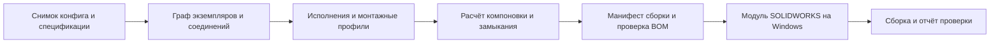

# Алгоритм автоматической сборки насосных установок в SOLIDWORKS

Техническое предложение от 20.10.2026 для текущей локальной рабочей копии.
Предлагаемая реализация должна получать выбранное оборудование из конфигурации
и спецификации проекта, рассчитывать монтажную геометрию и выпускать сборку
SOLIDWORKS с проверкой соответствия составу станции.

Основа решения — граф физических экземпляров и соединений между их монтажными
портами. Спецификация определяет состав, шаблон станции — схему соединений,
геометрические профили — размеры и монтажные базы. Расчётчик компоновки определяет
координаты; модуль SOLIDWORKS создаёт по ним детали, подсборки и сопряжения.

Это проект алгоритма и модели данных. CAD-генератор и миграции БД этим документом
не реализованы. Числа ниже относятся к проверенным локальным файлам и локальной
D1; состояние удалённой D1 ими не устанавливается.

## Что уже имеется в проекте

В приложении существуют три разных слоя данных. Насосы браузер читает из
`public/pumps.json`; комплектующие и проекты сервер получает из D1; соседняя
`database/pumps.sqlite` является прежним импортом Excel. Рабочую интеграцию CAD
следует строить над данными приложения, сохраняя происхождение импортов.

| Область | Проверенное состояние | Что использовать для CAD | Чего не хватает |
| --- | --- | --- | --- |
| Конфигурация станции | `ProjectConfig`: выбранные насосы, рабочие и резервные количества, второй контур, тип станции, DN, PN, материалы и опции | Входной снимок комплектации | Версия шаблона сборки, компоновочные параметры, ограничения и ручные монтажные переопределения |
| Спецификация | `SpecItem`: `equipmentId`, `quantity`, `section`, `option`, `assemblyRole`, `generatedBy`, `sourceFingerprint`, `selectedPn` | Связь с оборудованием и назначением позиции | Постоянный ID строки, точное физическое исполнение, распределение по экземплярам и соединениям |
| Каталог насосов | 5 856 записей в `public/pumps.json` | Идентичность модели, тип, часть физических характеристик | Однозначная связь каждого нужного исполнения с CAD и монтажным профилем |
| Патрубки насосов | 4 271 непустая запись входа, 5 205 выхода; обе записи у 4 261 модели | Частичная основа для проверки подключения | Полностью заполненные DN и тип соединения с обеих сторон имеются у 3 899 моделей; координат и направлений портов в `PumpPort` нет |
| Габариты насосов | У 249 моделей заполнены положительные `overall_length`, `base_length`, `base_width`, `flange_face_to_face`, `flange_center_height`; `overall_width` и `overall_height` — у 225 | Размеры после привязки к конкретному чертежу и системе координат | Полное покрытие выбранной номенклатуры, координаты отверстий и патрубков, зоны обслуживания |
| Прочие сведения о насосах | Непустой `dimensions` у 2 467 моделей, `mounting` у 2 181; поле `drawing` у 2 947 | Источники для подготовки геометрических профилей | Полноту нельзя считать по наличию объекта: внутри встречаются температура, кабель и текстовые признаки монтажа; `drawing` не является 3D-моделью |
| Комплектующие | В поставляемом `binding-components.json` — 1 827 позиций в 25 каталогах; в активном локальном импорте D1 — 1 820 | DN, PN, материал, семейство, часть размеров, цены и источники | Нормализованные монтажные размеры, порты, разрешённые ориентации и варианты исполнения |
| Размеры комплектующих в D1 | 251 числовое значение «Длина, мм», 100 толщин фланца; полная осевая длина воротника у 11 записей; болтовая окружность и число отверстий фланца у 20 | Подготовка проверенных профилей отдельных семейств | Покрытие неполное; длина изделия не всегда равна расстоянию между уплотнительными плоскостями |
| Коллекторы | Таблицы `collectors`, `collector_items`; 21 сохранённое изделие в локальной D1; конфигурация, BOM, длина магистрали и длины отводов | Параметрический генератор коллектора и состав его подсборки | Положение каждого отвода, торцевые припуски, монтажные плоскости, отверстия КИП, опоры и правила изготовления |
| Вставки | Локальные модули расчёта и таблицы `component_insertions`, `component_insertion_items`; в проверенной D1 сохранённых вставок 0 | DN, материал, тип геометрии, длина основы и сборки, осевые добавки, посадки, BOM, источники размеров | CAD-шаблоны, ориентация эксцентриситета, координаты концов и сгона КИП; связь выбора вставки в обвязке с конкретным рассчитанным изделием |
| Рама и опоры | В JSON есть 8 позиций рам, 16 опор, 10 кронштейнов | Исходная номенклатура для подбора | Для рам размеры преимущественно в названии; нет полного монтажного профиля и схемы крепления насосов, шкафа и коллекторов |
| Шкафы | Есть отдельные каталоги; в `control-cabinet-database.json` — 12 конфигураций NS Smart, у них строка `enclosureDimensions` | Внешний габарит и выбранная конфигурация шкафа | Структурированные размеры корпуса, крепёжные базы, стойки, ход двери и кабельные вводы |
| Окно 3D | `ModelEntity` хранит поворот и масштаб; в `page.tsx` отображается CSS-иллюстрация | Место для будущего просмотра | Реальная сцена, импорт геометрии, граф экземпляров и связь с CAD отсутствуют |
| Библиотека CAD | В проверенных доступных файлах рабочего каталога и верхнем ZIP-архиве не обнаружены SLDPRT, SLDASM, STEP, Parasolid или IGES; в схеме приложения нет CAD-реестра | Требуется создание библиотеки для выбранного пилота | Файлы моделей, версии, конфигурации, контрольные суммы и результаты проверки |

Основные источники в коде: [конфигурация проекта](../app/project-config.ts),
[схема D1](../db/schema.ts), [патрубки насосов](../app/pump-ports.ts),
[расчёт коллекторов](../app/collector-calculations.ts),
[расчёт вставок](../app/component-insert-calculations.ts),
[размеры фланцев](../app/flange-dimensions.ts),
[подготовка всасывающей линии](../app/suction-spec.ts),
[подготовка напорной линии](../app/discharge-spec.ts).

### Ограничения существующей идентификации

`equipmentId` используется для разных источников: насосов, строк каталога,
коллекторов и шкафов. Числовой `components.id` принадлежит локальной структуре
импорта, а `source_id` связывает запись с источником. Ни индекс строки интерфейса,
ни строка Excel, ни отображаемое название не должны становиться постоянным
CAD-идентификатором изделия между переимпортами.

Нужно ввести постоянный ID физического исполнения и таблицу его связей с
исходными записями. В исполнение входят серия, артикул, DN, PN, материал,
соединения, двигатель и значимые опции. Например, одна строка 017W содержит цены
для штока, рукоятки и редуктора; это разные монтажные габариты. Одного ID такой
строки для выбора 3D-модели недостаточно.

Статус спецификации `selected` не означает готовность к CAD: сейчас он связан
также с подбором и ценой. Геометрическая готовность должна проверяться отдельно.

## Архитектура реализации



Расчётчик состава и положения целесообразно реализовать как независимый
TypeScript-модуль, пригодный для тестирования без SOLIDWORKS. Он выдаёт манифест:
экземпляры, выбранные исполнения, параметры генерируемых деталей, порты,
преобразования координат, соединения, ссылки на позиции BOM и диагностику.

Для SOLIDWORKS предлагается отдельное приложение C# либо надстройка с доступом
к установленному SOLIDWORKS через COM. Такой способ расширения поддерживает
[официальный API standalone и add-in](https://help.solidworks.com/2025/english/api/sldworksapiprogguide/GettingStarted/SolidWorks_API_Standalone_and_Add-in_Applications_Overview.htm?id=1.2.2.0).
Существующий Cloudflare Worker отвечает за конфигурации, метаданные и задания;
исполнение COM вынесено на Windows-компьютер с установленной согласованной
версией SOLIDWORKS и доступной лицензией.

Для первого этапа достаточно экспорта JSON-манифеста и его открытия локальным
генератором. Следующий этап — очередь заданий, которую Windows-исполнитель
забирает по HTTPS. В одном экземпляре SOLIDWORKS задания выполняются
последовательно. Каждое задание имеет отдельный выходной каталог и журнал.

Исходные CAD-файлы хранятся в библиотеке файлов, объектном хранилище либо PDM;
в D1 — их идентификаторы, версии и контрольные суммы. Бинарные модели не следует
вкладывать в `config_json`: существующий API сохранения проекта ограничивает
размер запроса 2 000 000 символов.

## Требования к моделям комплектующих

Для сборки достаточно качественного импортированного твёрдого тела, если его
монтажная геометрия описана полностью. Восстанавливать историю построения каждой
покупной детали необязательно. Рабочий формат библиотеки — SLDPRT или SLDASM;
STEP и Parasolid принимаются как исходники и проходят подготовку профиля.
STL и GLB можно использовать для просмотра, но они не заменяют проверенную
монтажную геометрию для конструкторской сборки.

| Требование | Правило подготовки |
| --- | --- |
| Точное исполнение | Файл и конфигурация соответствуют выбранной физической модификации, включая двигатель, привод, тип фланца и материал, когда он влияет на конструкцию |
| Масштаб | Физический масштаб 1:1; единицы известны; запрещено растягивать покупную деталь для стыковки |
| Локальная база | Для подготовленной модели определены начало, оси и монтажная плоскость; для насоса удобна база на опорной поверхности с Z вверх |
| Монтажные порты | У каждого подключения есть ID, координаты, полная ориентация и тип присоединения; у насоса минимум всасывание, нагнетание и профиль крепления |
| Поворот вокруг оси | Кроме оси патрубка задаётся направление X порта: оно фиксирует расположение отверстий, рукоятки или эксцентриситета |
| Крепление | Плоскости опирания, центры и диаметры отверстий либо пазов, допустимые направления регулировки, схемы установки виброопор |
| Габариты | Точный внешний контур или консервативная оболочка, включая двигатель, клеммную коробку, привод и рукоятки |
| Обслуживание | Отдельные зоны открытия шкафа, снятия двигателя, извлечения обратного клапана, поворота рукоятки и доступа инструментом |
| Устойчивая привязка | Именованные базы, оси и системы координат; ID портов не зависит от номера грани после изменения модели |
| Геометрическая корректность | Модель открывается и перестраивается без ошибок; обязательные тела и базы не подавлены в выбранной конфигурации |
| Параметрические изделия | Для трубы, коллектора, вставки и рамы определены имена параметров, диапазоны, единицы и вычисление портов после перестроения |
| Версия | Зафиксированы ревизия файла, конфигурация, SHA256, версия SOLIDWORKS и результат приёмки профиля |
| Нагрузочные данные | Масса и центр тяжести нужны для расчёта опор и рамы; для заполненных трубопроводов отдельно учитывается масса жидкости |

Можно сохранить исходный файл поставщика и создать подготовленную модель либо
обёртку с базами `CS_BASE`, `CS_INLET`, `CS_OUTLET`, `MOUNT_BASE`.
Для точного сопряжения через оси и плоскости в библиотеке сохраняется также
связь ID порта с соответствующей именованной CAD-геометрией. Внешние ссылки
должны быть разрешимы в изолированном каталоге выпуска.

### Состав монтажного порта

Каждый порт содержит:

- `id`, назначение и локальную матрицу `T_component_port`;
- DN отдельно от фактических диаметров, PN либо допустимое давление;
- тип соединения и стандарт;
- для фланца — исполнение уплотнительной поверхности, болтовую окружность,
  число и диаметр отверстий, фазу отверстий относительно X порта;
- для резьбы — стандарт G, R, Rp, Rc или NPT, размер, шаг, наружное/внутреннее
  исполнение и подтверждённую монтажную глубину;
- для сварки — наружный диаметр, стенку, подготовку торца, зазор и допустимую
  глубину посадки;
- направление потока, разрешённые ориентации установки, допустимый поворот
  вокруг оси и ограничения доступа;
- источник размеров, ревизию и статус проверки.

DN и PN сами по себе не доказывают совместимость. Например, круглый фланец,
овальный фланец насоса и переходная ответная часть могут иметь одинаковое
условное обозначение прохода при разной геометрии крепления.

## Последовательность алгоритма

1. **Зафиксировать входной снимок.** Сохранить проект, спецификацию, версии
   каталогов, выбранных физических исполнений и правил расчёта. Сверить
   выбранные насосы и количества в `station`, `InputEntity` и строках BOM.
   Противоречие должно давать диагностическую ошибку с указанием источников.
2. **Выбрать шаблон станции.** Например, один ряд вертикальных насосов с двумя
   общими коллекторами. Для горизонтальных насосов, двух контуров и жокея
   использовать отдельные версии шаблонов с явной топологией.
3. **Сформировать физические экземпляры.** Три насоса в одной строке
   спецификации превращаются в три экземпляра с постоянными ID и назначением
   рабочего/резервного. Точно так же разворачиваются линии, фланцы и приборы.
   Для строки «комплект» необходима явная ведомость состава: количество
   комплектов само по себе не определяет число болтов или опор.
4. **Построить граф соединений.** Для каждого экземпляра указать, какой порт
   соединён с каким портом, через какую прокладку, ответную часть или сварной
   стык. Шаблон использует роли `assemblyRole`, но не порядок строк и не текст
   `details` как программный интерфейс.
5. **Разрешить геометрию.** Получить точные CAD-конфигурации и монтажные профили;
   проверить подключения и допустимые ориентации. Отсутствующие критичные данные
   возвращать как `missing_geometry`, без подстановки модели похожего изделия.
6. **Построить монтажный каркас.** Определить плоскость рамы, оси насосов,
   положение коллекторов, стойки шкафа и требуемые зоны обслуживания. Начальные
   расстояния брать из проекта; изменять только параметры, разрешённые политикой
   автоматической компоновки.
7. **Решить размерные цепи.** Рассчитать положения узлов по портам и допустимые
   длины изготавливаемых элементов. Проверить одновременно всасывающую и напорную
   стороны всех насосов. При изменении межосевого расстояния пересчитать оба
   коллектора, раму и их BOM.
8. **Сгенерировать собственные изделия.** По итоговым параметрам создать трубы,
   вставки, коллекторы и раму из шаблонов. Проверить полученные порты и размеры
   после перестроения. Покупные детали сохраняют свои размеры.
9. **Проверить сборку до CAD.** Проверить замыкание графа, зазоры оболочек,
   ориентации арматуры, доступность обслуживания и соответствие количеств.
10. **Выпустить манифест.** Сохранить экземпляры, матрицы, соединения, размеры,
    ошибки, выбранные версии и хеш входа. При блокирующих ошибках конструкторский
    выпуск недоступен; приблизительный просмотр должен явно показывать упрощения.
11. **Создать сборку SOLIDWORKS.** Открыть нужные конфигурации, создать подсборки,
    вставить экземпляры, назначить преобразования и предусмотренные сопряжения,
    перестроить, проверить результат и сохранить в новый каталог выпуска.
12. **Сверить выход.** Сравнить фактические CAD-экземпляры, параметры и количества
    с манифестом; проверить стыки и коллизии после перестроения. Выдать SLDASM
    со всеми зависимостями, при необходимости STEP, и отчёт с ID ошибок.

Всасывающий путь типового шаблона проходит от коллектора через выбранную
запорную арматуру и предусмотренные переходные элементы к насосу. Напорный
путь — от насоса через предусмотренные переходные элементы, обратный клапан
и запорную арматуру к коллектору. Конкретная последовательность должна
соответствовать утверждённой схеме и текущему выбору виброкомпенсаторов;
одной универсальной последовательности для всех исполнений нет.

### Общая модель состава для спецификации и CAD

Сейчас `buildSuctionSpec` и `buildDischargeSpec` формируют агрегированные
коммерческие строки. Рекомендуется выделить общий построитель
`station-assembly-plan.ts`, возвращающий физические узлы и соединения.
Из этого плана получать агрегированную спецификацию и CAD-манифест.
Так правила состава не будут расходиться между двумя подсистемами.

Для каждой позиции фиксируется реально использованный источник: активный
импорт D1, поставляемый JSON или сохранённое рассчитанное изделие. Разница
между 1 827 позициями JSON и 1 820 позициями локальной D1 требует сопоставления
идентичности и ревизий; объединять их по названию при выпуске CAD нельзя.

Нужно различать геометрические детали, материалы по длине и операции.
Сварка, окраска и лён остаются в учёте, но не получают фиктивных твёрдых тел.
Если вставка представлена подсборкой с двумя фланцами, отдельные позиции
этих фланцев должны ссылаться на уже существующие дочерние экземпляры.
Повторно добавлять их рядом со вставкой нельзя. Аналогично сумма отрезков
трубы в метрах сверяется с материальной строкой, а не с числом CAD-экземпляров.

## Расчёт положения компонентов

### Системы координат

Для станции принимаются X вдоль ряда насосов, Y от всасывающего коллектора к
напорному, Z вверх. Монтажные профили используют миллиметры и радианы.
Каждый компонент и каждый порт имеют правую систему координат.
У порта Z направлена наружу из компонента, X задаёт угловую ориентацию.

Положение компонента — жёсткое преобразование `T = [R, t; 0, 1]`,
где `R` — ортонормальная матрица вращения, `t` — перенос. Масштаб равен 1,
`det(R) = +1`: зеркалирование не применяется для разворота покупного насоса.
В расчётных формулах ниже используются векторы-столбцы.

### Положение следующей детали через соединяемые порты

Если A уже установлена, а порт `p` детали A соединяется с портом `q` детали B:

```text
T_world_B = T_world_A × T_A_p × C_pq × inverse(T_B_q)
```

`T_A_p` и `T_B_q` — локальные системы координат портов.
`C_pq` задаёт монтажный зазор или глубину посадки, встречное направление
осей и поворот фланцев. Для выбранного соглашения портов удобно:

```text
C_pq = Translation(0, 0, g) × RotationZ(phi) × RotationX(pi)
```

Здесь `g` отсчитывается вдоль наружной Z порта A, `phi` — допустимый
угол согласования. Для прямого контакта плоскостей `g = 0`.
Применимость значения `g` задаётся правилом конкретного соединения.
Резьбовая глубина не равна нулю по умолчанию и не определяется только по DN.

Если прокладка моделируется отдельной деталью, её сжатая монтажная толщина
задана расстоянием между её портами; дополнительные зазоры на обоих стыках
нулевые. Если прокладка учтена только в BOM, толщина вводится в `g` один раз.
Свободная и установленная длины компенсатора также различаются явно.

Иллюстрация размерной цепи с условными, не каталожными числами: если
уплотнительная плоскость одной детали находится на Y = 100 мм, прокладка
в установленном состоянии имеет толщину 2 мм, а следующий корпус имеет
расстояние между своими монтажными плоскостями 50 мм, его выходная плоскость
будет на Y = 152 мм при сонаправленной прямой цепи. Координата начала CAD-файла
этой детали дополнительно зависит от локального смещения входного порта.

### Размещение ряда насосов

Для одинаковых насосов с шагом `s` и нумерацией `i = 0 ... N−1`:

```text
x_i = x_0 + i × s
```

`s` должен обеспечить зазоры по установленным габаритам насосов, приводов и
арматуры, а также обслуживание. Для соседних разных изделий:

```text
x_(i+1) − x_i >= rightExtent_i + leftExtent_(i+1) + clearance_i
```

Выступы вычисляются от выбранных монтажных баз с учётом ориентации.
Предварительная оценка шага для одинаковых компонентов —
`s >= max(width_pump + gap_pump, width_valve + gap_valve, ...)`;
окончательное решение проверяет реальные оболочки и зоны обслуживания.

Например, три одинаковых насоса при заданном проектом шаге 500 мм получают
оси X = 0, 500, 1 000 мм. Это иллюстрация размещения, а не назначение
универсального достаточного шага 500 мм.

### Коллекторы и размерные цепи

После размещения насосов координаты их патрубков определяются преобразованием
локальных портов. Цепи арматуры дают требуемые положения портов отводов
коллекторов. Для разных насосов или двух контуров смещения патрубков могут
различаться; отводы нельзя расставлять только по наружной ширине насосов.

Для прямой магистрали с известными крайними осями отводов:

```text
L_pipe = endAllowanceLeft + (x_last − x_first) + endAllowanceRight
```

Это длина тела магистральной трубы при таком определении припусков; общая
длина коллектора по торцевым уплотнительным плоскостям дополнительно учитывает
концевые детали и их посадку. Каждый припуск получает отдельный источник.

В существующем коде `collectorLength = Σ(N_circuit × spacing_circuit)`,
а `branchLength = 0.5 × D_outer + 1.1 × L_bolt`. Эти формулы используются
текущим расчётом коллекторов. Они не определяют целиком производственную
геометрию: требуются правила начала и конца отводов, посадки фланцев,
торцевые припуски, стыки групп и положение эксцентриситета. Флаг `eccentric`
в текущей конфигурации сам по себе не задаёт смещение монтажного порта.

Для прямой соединительной трубы с расстоянием между целевыми плоскостями `D`:

```text
L_cut = D − Σ(faceToFace_j) − Σ(gap_k) − endAdditionLeft − endAdditionRight
```

Все слагаемые должны иметь согласованные базы и знаки. Осевые добавки
фланцев включают фактическую посадку; общая высота фланца не подменяет добавку.
Для маршрута с отводами расчёт выполняется векторами по локальным портам;
скалярной формулы по общей длине уже недостаточно.

### Замыкание графа

Одно последовательное прохождение графа определяет положения только на
выбранном остовном дереве. Подключение всех насосов к двум общим коллекторам
создаёт дополнительные условия замыкания. Для каждого соединения проверяются
расхождения центров портов, встречность нормалей и угловая фаза.

Сначала решаются аналитически параметры типового шаблона: шаг насосов,
положение коллекторов, длины разрешённых вставок и высоты опор. При наличии
нескольких свободных размеров можно применять ограниченный численный решатель,
сохраняя минимальные длины и фиксированные проектом параметры как ограничения.
Если решение отсутствует, отчёт должен назвать несовместимые стыки и размеры.
Растягивать арматуру, деформировать компенсатор сверх допустимого или
игнорировать незамкнутую ветвь нельзя.

Порог геометрической проверки — параметр проекта/шаблона. Например, 0,1 мм
и 0,1° можно принять для пилотной программной проверки после согласования;
это не назначение производственного допуска всем деталям.

## Работа модуля SOLIDWORKS

Геометрию следует сначала разместить по рассчитанным матрицам. API поддерживает
[пакетную вставку AddComponents3](https://help.solidworks.com/2018/english/api/sldworksapi/SOLIDWORKS.Interop.sldworks~SOLIDWORKS.Interop.sldworks.IAssemblyDoc~AddComponents3.html)
с преобразованиями и системами координат компонентов. Для каждой вставки
необходимо явно устанавливать и проверять нужную конфигурацию модели.

Между расчётчиком и API нужен отдельный адаптер. Обычная матрица 4×4 не
копируется напрямую в массив SOLIDWORKS: у
[IMathTransform](https://help.solidworks.com/2023/english/api/sldworksapi/SOLIDWORKS.Interop.sldworks~SOLIDWORKS.Interop.sldworks.IMathTransform.html?verRedirect=1)
первые 9 значений описывают вращение, следующие 3 — перенос, далее масштаб
и 3 неиспользуемых значения. Адаптер учитывает порядок элементов,
соглашение о векторах и контекст вложенной подсборки.

Размеры передаются в API в метрах, углы — в радианах, если конкретный метод
не устанавливает другое правило; это указано в
[справке по единицам SOLIDWORKS API](https://help.solidworks.com/2024/english/api/sldworksapiprogguide/Overview/Units.htm?id=1.4.71).
Перевод мм в м выполняется на одной границе, без повторного масштабирования.

Для подготовленных файлов можно нормализовать начало CAD-файла к базе
монтажного профиля. Если начало не совпадает, сохраняется преобразование
`T_component_file`, тогда `T_world_file = T_world_component × T_component_file`.
Использование именованной системы координат в `AddComponents3` должно учитывать
эту же привязку и не применять смещение повторно.

Предлагаются два режима генерации:

- Для проверки автоматической компоновки экземпляры устанавливаются по матрицам
  и фиксируются. Параметры меняются в конфигурации и сборка регенерируется.
- Для редактируемого конструкторского выпуска неподвижная база фиксируется,
  остальные элементы получают согласованный минимальный набор сопряжений по
  именованным плоскостям, осям и монтажным базам. Соосности недостаточно:
  требуется ограничить осевой сдвиг и допустимый поворот.

Один экземпляр не должен одновременно иметь несовместимую фиксацию и полный
набор управляющих сопряжений. Сопряжения не используются как способ случайно
найти требуемую компоновку. В текущей справке
[IAssemblyDoc](https://help.solidworks.com/2026/English/api/sldworksapi/SolidWorks.Interop.sldworks~SolidWorks.Interop.sldworks.IAssemblyDoc_members.html)
для новых сопряжений предусмотрены `CreateMateData` и `CreateMate`,
а `AddMate5` помечен устаревшим. Адаптер проверяется на фактически используемой
версии SOLIDWORKS.

После перестроения надо повторно прочитать положения экземпляров и их портов,
проверить число деталей и выполнить точную проверку пересечений через
[IInterferenceDetectionMgr.GetInterferences](https://help.solidworks.com/2026/English/api/sldworksapi/SOLIDWORKS.Interop.sldworks~SOLIDWORKS.Interop.sldworks.IInterferenceDetectionMgr~GetInterferences.html).
Предварительная проверка оболочек ускоряет расчёт, но не заменяет эту стадию.
Ожидаемый контакт и подтверждённые посадки задаются правилами конкретных
соединений; нельзя исключать из проверки все соседние детали целиком.

## Предлагаемые дополнения к БД

Логические сущности ниже дополняют существующие таблицы; перевод приложения
на другую СУБД для первого этапа не требуется. Большие файлы и отчёты
хранятся вне D1, а данные расчёта могут первоначально лежать в проверяемом JSON
с обязательной версией структуры.

| Сущность | Основные поля | Назначение |
| --- | --- | --- |
| `equipment_variants` | `id`, тип оборудования, производитель, артикул, физическое исполнение, `revision`, статус | Постоянная инженерная идентичность насоса, арматуры, шкафа или собственного изделия |
| `equipment_variant_sources` | `variant_id`, namespace источника, ID записи, ревизия/хеш импорта | Связь с существующими насосами, `components.source_id`, коллекторами, вставками и шкафами |
| `cad_models` | `id`, `variant_id`, URI файла, формат, конфигурация, SHA256, версия SOLIDWORKS, ревизия, статус проверки | Однозначный выбор CAD-представления; параметрический шаблон допускается для семейства с явными диапазонами |
| `component_geometry` | `id`, `variant_id`, ревизия, размеры, `T_component_file`, габаритная оболочка, базы и отверстия крепления, зоны обслуживания, масса/центр тяжести, источники | Проверенный геометрический профиль исполнения; `cad_models` ссылается на его конкретную ревизию |
| `component_ports` | `geometry_id`, ID/роль порта, локальные позиция и ориентация, тип, DN/PN, параметры фланца/резьбы/сварки, разрешённые ориентации, CAD-базы | Монтажные соединения; уникальность ID порта внутри ревизии профиля |
| `connection_rules` | ID и версия, типы сопрягаемых портов, условия совместимости, прокладка/посадка, разрешённые углы, крепёжный пакет | Геометрия и проверка стыка без разбора отображаемых названий |
| `assembly_templates` | ID и версия, семейство станции, топология, роли, правила компоновки, параметры и ограничения | Схема станции, например ряд вертикальных насосов с общими коллекторами |
| `assembly_runs` | ID проекта, хеш/URI неизменяемого входного снимка, версия решателя и шаблона, хеш манифеста, статус, диагностика | Воспроизводимость конкретного выпуска и определение устаревания |
| `assembly_instances` | `run_id`, `instance_id`, родитель, роль/контур/номер ветви, ID строки BOM, `variant_id`, CAD/геометрическая ревизия, параметры, матрица, режим учёта | Каждый физический экземпляр и его связь с составом |
| `assembly_connections` | `run_id`, экземпляры и ID портов, версия правила стыка, монтажные параметры, ошибки замыкания | Граф соединений и проверка размерных цепей |
| `cad_jobs` | `run_id`, статус/lease, исполнитель, версии API/шаблонов, число попыток, журнал, выходные URI/хеши | Надёжное исполнение и повтор задания без дублирования выпусков |

Для параметрических изделий профиль предоставляет порты как результат
разрешённого генератора размеров. В БД хранится ID/версия генератора и его
параметры, а не произвольный исполняемый код. Профили разных CAD-конфигураций
должны быть связаны с соответствующими размерами и портами.

### Изменения конфигурации проекта

Добавить блок `assembly` с собственной версией структуры:

```text
assembly:
  schemaVersion
  templateId, templateVersion
  layout:
    coordinateConvention
    pumpOrderByInstanceId
    pitchByCircuitMm
    collectorPositionsOrConstraints
    frameTypeAndDimensions
    cabinetSideAndMounting
    installationAndServiceClearances
  overridesByInstanceId
  automaticAdjustmentPolicy
  acceptedGeometryApproximations
  lastAssemblyRunId
```

В строки спецификации добавить постоянный `id`, `equipmentVariantId`,
ревизию исполнения и выбранные физические опции. Связь с экземплярами лучше
хранить в плане/выпуске сборки: одна строка может соответствовать нескольким
деталям или длине материала. Матрицы и полную CAD-геометрию не следует
сохранять только внутри состояния окна просмотра.

Текущий `parseProjectConfig` принимает `schemaVersion: 1`. Изменения должны
иметь явную миграцию и проверку новых полей; переход на версию 2 без поддержки
старых файлов приведёт к отказу загрузки существующих проектов.

Любое изменение выбранного оборудования, физического исполнения, геометрии,
шаблона или монтажных параметров меняет хеш входа и помечает прежнюю сборку
устаревшей. Изменение только цены не обязано менять геометрию, но обновление
ценового снимка спецификации должно быть прослеживаемым.

## Порядок внедрения и приёмка

Начать следует с одного утверждённого семейства: ряд одинаковых вертикальных
насосов, один контур, общие коллекторы и конкретные серии арматуры.
Покрывать геометрией сразу все 5 856 моделей насосов не требуется.

1. Подготовить одну эталонную сборку вручную и зафиксировать её монтажные базы,
   последовательность арматуры, правила крепления и обслуживания.
2. Для всего состава эталона создать CAD-файлы/конфигурации и монтажные профили.
   Включить раму, опоры, шкаф, прокладки и переходные детали выбранного исполнения.
3. Реализовать постоянные идентификаторы и общий план состава станции.
4. Реализовать расчёт положения, замыкание, проверку размеров и выдачу манифеста.
5. Подключить локальный генератор SOLIDWORKS и сверить выпуск с эталоном.
6. Добавить варианты числа насосов, затем другие DN, соединения и материалы;
   после этого — два контура, жокей и горизонтальные насосы.

До реализации надо зафиксировать используемую версию SOLIDWORKS, доступное
исполнение лицензии, библиотеку шаблонов, допустимые семейства станций,
правила изготовления рамы и коллекторов, перечень обязательных выходных
документов и допустимость упрощений для просмотра.

Критерии приёмки пилота:

- каждый выбранный физический компонент связан с точным исполнением и
  корректной CAD-конфигурацией;
- все требуемые порты и монтажные базы известны, соединения совместимы;
- рабочие и резервные насосы присутствуют физически, даже если гидравлический
  расчёт учитывает работу только части насосов;
- все ветви замкнуты в заданных геометрических порогах, нет непредусмотренных
  пересечений и нарушений зон обслуживания;
- количества деталей и длины материалов согласованы с одним планом состава;
  дочерние фланцы и крепёж не продублированы;
- сборка открывается со всеми зависимостями и перестраивается без ошибок,
  а фактические положения после перестроения соответствуют манифесту;
- повторный расчёт одного входного снимка даёт те же экземпляры, параметры
  и положения в пределах числового допуска; побайтовая идентичность SLDASM
  не требуется;
- смена насоса, DN, PN, исполнения привода, опции виброкомпенсаторов или
  межосевого расстояния корректно пересчитывает зависимые узлы;
- отсутствие критичного размера, CAD-модели, несовместимый фланец или невозможная
  длина дают адресную ошибку и блокируют конструкторский выпуск.

Обязательные проверки расчётчика включают жёсткие преобразования и единицы,
поворот отверстий фланцев, одну и две прокладки межфланцевой арматуры,
резьбовую посадку, эксцентрический переход, замыкание нескольких ветвей и
соответствие BOM. Проверки генератора выполняются на установленном SOLIDWORKS
для используемой версии и эталонных файлов.
